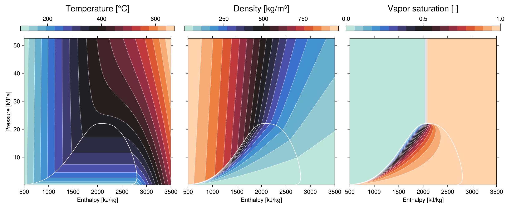

# Governing equations in geothermal energy

Fimbul currently supports pure H₂O as a single-component, two-phase
fluid system. Water may be present in a liquid phase ($L$) and/or a vapor phase
($V$).

## Conservation of mass
Mass conservation is written as

```math
    \partial_t\left([1-\phi]\rho_R + \phi[\rho_L s_L + \rho_V s_V]\right)
    + \nabla \cdot \left(\rho_L \vec{v}_L + \rho_V \vec{v}_V\right)
    = Q_M, \tag{1}
```

where $\phi$ is porosity, $\rho_\alpha$ is density for the rock ($\alpha = R$)
or fluid phase ($\alpha \in \{L, V\}$), and $s_\alpha$ is phase saturation
(the fraction of pore volume occupied by phase $\alpha$, with $s_L + s_V = 1$).
The term $Q_M$ denotes mass sources and sinks, including wells and boundary
fluxes. Phase velocities are given by Darcy's law,

```math
    \vec{v}_\alpha = - \frac{k_{r,\alpha}}{\mu_\alpha} \mathbf{K} \left(\nabla p - \rho_\alpha g \nabla z\right),
```

where $k_{r,\alpha}$ is relative permeability, $\mu_\alpha$ is viscosity,
$\mathbf{K}$ is absolute permeability, $p$ is pressure, $g$ is gravitational
acceleration, and $z$ is depth (positive downwards).

> NOTE: In practice, the interface between liquid and vapor phases in an
> H₂O system may exhibit non-negligible capillary pressure effects.
> This is currently not modeled in Fimbul; support is planned for a future
> release.

## Conservation of thermal energy
Thermal energy conservation is expressed as

```math
\begin{aligned}
    &\partial_t\left([1-\phi]\rho_R u_R + \phi[\rho_L s_L u_L + \rho_V s_V u_V]\right)\\
    &\quad + \nabla \cdot \left(\rho_L h_L \vec{v}_L + \rho_V h_V \vec{v}_V\right)
    - \nabla \cdot \left(\mathbf{\Lambda}\nabla T\right)
    = Q_H,
\end{aligned} \tag{2}
```

where $u_\alpha$ is specific internal energy,
$h_\alpha = u_\alpha + p/\rho_\alpha$ is specific enthalpy, $T$ is temperature, and $\mathbf{\Lambda}$
is the effective thermal conductivity tensor of the rock–fluid mixture. The
second term on the left represents advective heat transport by the flowing
phases; the third term is conductive heat transport via Fourier's law,

```math
    \vec{q}_c = - \mathbf{\Lambda}\nabla T.
```

The term $Q_H$ denotes thermal energy sources and sinks, and generally consists
of an advective part (e.g., heat transported with injected fluid), and a
conductive part (e.g., heat from a closed, hot wellbore).

## Fluid properties
The fluid properties of H₂O—such as density, viscosity, enthalpy,
and phase state—depend on pressure and enthalpy (or temperature) and are
provided through precomputed lookup tables.

For the high-enthalpy (two-phase) regime, the steam tables are generated using
the [`CoolProp`](https://www.coolprop.org/) library [bell_pure_2014](@cite) via
the `FimbulCoolPropExt` extension. They are stored as `Artifacts` that are
loaded automatically when using the high-enthalpy formulation. The tables can
also be loaded directly using the `Artifacts` API. To generate your own tables,
see `build_steam_tables_h2o` in `FimbulCoolPropExt`.

The figure below shows the temperature, density, and vapor saturation of
H₂O as functions of pressure and specific enthalpy, covering the
full range of both single-phase and two-phase states. The saturation line
separates the single-phase liquid region (left), two-phase region (center), and
single-phase vapor region (right). These phase diagram contours can be
visualized using `plot_phase_diagram_contours`.



For the low-enthalpy (single-phase liquid) regime, Fimbul uses PVT tables from
JutulDarcy generated using the [NIST
database](https://webbook.nist.gov/chemistry/fluid/). In this case, $s_V = 0$,
so that only liquid terms in Equations (1) and (2) remain.

## Wells
Flow in wells can be modeled in two different ways:
- As a simple well where flow in and out of the wellbore is computed based on an
  explicitly computed pressure drawdown from the top to each perforated cell—see
  JutulDarcy's [`SimpleWell`](@extref JutulDarcy.SimpleWell). In this
  formulation, the entire wellbore gets a single temperature, which in many
  cases is a poor approximation for geothermal wells.
- As a multisegment well where each wellbore is discretized as a 1D object with
  its own conservation equations for mass and energy, with accompanying pressure
  and heat variables (either temperature or enthalpy depending on the
  formulation)—see JutulDarcy's
  [`MultiSegmentWell`](@extref JutulDarcy.MultiSegmentWell).

In geothermal energy, heat is exchanged with the formation along the entire
wellbore, so a multisegment well formulation is the preferred modeling choice. For closed-loop geothermal wells (e.g., AGS,
BHE and BTES), a multisegment well formulation is necessary, since temperature
changes along the wellbore are crucial to model. All examples in Fimbul use the
multisegment well formulation. This models conservation of mass and energy as in
Equations (1) and (2), but with only void space, $\phi = 1$. Wellbore fluxes are
computed on the segments that connect the well nodes. The primary unknown on a
segment from node $a$ to node $b$ is the total mass flow $q$, which is
determined by balancing the potential difference between the nodes against the
frictional pressure drop along the segment,

```math
    p_a - p_b - \bar\rho g (z_a - z_b) = \Delta p_f(q),
    \qquad
    \Delta p_f = 2 f \frac{L}{D_h} \rho v |v|,
    \qquad
    v = \frac{q}{\rho A},
```

where $\bar\rho$ is the average of the mixture densities in the
two nodes, $L$ is the segment length, $A = \pi(r_o^2 - r_i^2)$ is the
cross-sectional area of the flow path, and $D_h = 2(r_o - r_i)$ is its
hydraulic diameter, with $r_o$ and $r_i$ the outer and inner radius ($r_i = 0$
for a pipe, $r_i > 0$ for an annulus). The mixture density $\rho$ and viscosity
$\mu$ are saturation-weighted averages over the phases, taken from the upstream
node. The Fanning friction factor $f$ depends on the Reynolds number
$\mathrm{Re} = \rho |v| D_h/\mu$,

```math
    f = \begin{cases}
        16/\mathrm{Re}, & \mathrm{Re} \leq 2000 \quad \text{(laminar)},\\[4pt]
        \left[-3.6 \log_{10}\left(\dfrac{6.9}{\mathrm{Re}}
        + \left(\dfrac{\varepsilon}{3.7 D_o}\right)^{10/9}\right)\right]^{-2},
        & \mathrm{Re} \geq 4000 \quad \text{(turbulent)},
    \end{cases}
```

where $\varepsilon$ is the pipe roughness and $D_o = 2r_o$ (Haaland's
correlation). In between, $f$ is interpolated linearly in $\mathrm{Re}$ between
the laminar and turbulent values. The mass flow from node $a$ to node $b$ is
$q$, and the corresponding heat flow is

```math
    q_{H} = q \sum_\alpha x_\alpha h_\alpha + G_{ab}\left(T_a - T_b\right),
```

where $x_\alpha = \rho_\alpha s_\alpha / \sum_\beta \rho_\beta s_\beta$ is the
mass fraction of phase $\alpha$ and the phase enthalpies $h_\alpha$ are taken
from the upstream node. The last term is heat conduction between the nodes,
with $G_{ab}$ the thermal conductance of the segment. It is zero by default,
but closed-loop wells use it for the thermal resistances between pipe and grout
nodes, which are connected by segments without flow ($q = 0$), with
$G_{ab} = L/R_{ab}$—see [Closed-loop wells](#Closed-loop-wells).

Perforations of both simple and multisegment wells compute mass and conductive
heat flow using Peaceman-type well indices, with the exception of U-tube and
coaxial closed-loop wells (see below). The well index $\mathrm{WI}$ is computed
with Peaceman's formula—see
[`compute_peaceman_index`](@extref JutulDarcy.compute_peaceman_index)
and the [JutulDarcy documentation on
wells](@extref JutulDarcy man/basics/wells). For
a perforation connecting well node $w$ to reservoir cell $c$, the mass flow of
phase $\alpha$ from the well into the reservoir (positive for injection) is

```math
    q_\alpha = \mathrm{WI}\, m_\alpha \left(p_w - p_c - \bar\rho_\alpha g (z_w - z_c)\right),
```

where $\bar\rho_\alpha$ is the average of the phase densities in the well node
and the reservoir cell. The mass mobility $m_\alpha$ is
$\rho_\alpha k_{r,\alpha}/\mu_\alpha$ of the reservoir cell for production. For
injection, it is $\rho_\alpha s_\alpha$ of the well node times the total
mobility $\sum_\beta k_{r,\beta}/\mu_\beta$ of the reservoir cell. The heat flow
from the well into the reservoir is the sum of advective and conductive heat
flow,

```math
    q_H = \sum_\alpha h_\alpha q_\alpha + \mathrm{WI}_{th}\left(T_w - T_c\right),
```

where the phase enthalpy $h_\alpha$ is taken from the well for injection and
from the reservoir cell for production.

### Thermal well index
The thermal well index $\mathrm{WI}_{th}$ accounts for conduction through the
well casing, the grout surrounding the casing, and the rock. These are treated
as thermal resistances in series,

```math
    \mathrm{WI}_{th} = \frac{2\pi L}{R_c + R_g + R_r},
```

where the casing, grout and rock terms are

```math
    R_c = \frac{\ln(r_w/r_{c})}{\lambda_c}, \qquad
    R_g = \frac{\ln(r_g/r_w)}{\lambda_g}, \qquad
    R_r = \frac{\ln(r_e^{th}/r_g)}{\Lambda_e}.
```

Here, $r_{c} = r_w - t_c$ is the inner radius of a casing of thickness
$t_c$, $r_g = r_w + t_g$ is the outer radius of a grout layer of thickness
$t_g$, and $\lambda_c$ and $\lambda_g$ are the casing and grout thermal
conductivities. A term is omitted if the corresponding thickness is zero.
The rock term uses Peaceman's formula with thermal conductivity in place of
permeability: $\Lambda_e = \sqrt{\Lambda_1\Lambda_2}$ is computed from the
effective rock–fluid conductivity
$\Lambda = \phi\Lambda_f + (1-\phi)\Lambda_R$, and $r_e^{th}$ is the
Peaceman equivalent radius computed with $\Lambda$ in place of $\mathbf{K}$
and the Peaceman constant doubled ($0.56$ instead of $0.28$). Both indices
can also be set directly when setting up
the well (`WI` and `WIth` in [`setup_well`](@extref JutulDarcy.setup_well)).

### Closed-loop wells
Closed-loop wells (see [`setup_closed_loop_well`](@ref)) do not exchange mass with the
reservoir, so $\mathrm{WI} = 0$, and heat is exchanged by conduction only.
Fimbul represents the cross-section of the borehole as a network of nodes
(pipes and grout) connected by thermal resistances, following the thermal
resistance and capacity model described in [feflow_btes](@cite). The heat
flow between two connected nodes $a$ and $b$ (or between a grout node and the
reservoir) is

```math
    q_{H} = \frac{L}{R_{ab}}\left(T_a - T_b\right),
```

where $R_{ab}$ is the thermal resistance per unit length. In the expressions
below, $d_g = 2r_g$ is the borehole diameter, $\lambda_g$ is the grout
thermal conductivity, and subscripts $i$ and $o$ denote the inner and outer
radius of a pipe wall. The convective (fluid-to-pipe-wall) resistances inside
the pipes are currently neglected.

**Generic closed-loop well** ([`ClosedLoopGenericWell`](@ref)): the pipe exchanges heat
directly with the reservoir through $\mathrm{WI}_{th}$, as computed above with
the pipe wall as casing and the surrounding grout.

**Single U-tube** ([`ClosedLoop1UWell`](@ref)): two pipes with outer diameter
$d_p = 2r_{p,o}$ and pipe wall thermal conductivity $\lambda_p$, each connected
to its own grout node. With $w$ the shank spacing (the center-to-center
distance between the two pipes) and

```math
    x = \frac{\ln\left(\sqrt{d_g^2 + 2d_p^2}/(2d_p)\right)}{\ln\left(d_g/(\sqrt{2}d_p)\right)}, \qquad
    R_g = \left(1.601 - 0.888\frac{w}{d_g}\right)
    \frac{\cosh^{-1}\left(\frac{d_g^2 + d_p^2 - w^2}{2d_g d_p}\right)}{2\pi\lambda_g},
```

the resistances are

```math
\begin{aligned}
    R_{pg} &= \frac{\ln(r_{p,o}/r_{p,i})}{2\pi\lambda_p} + xR_g
    &&\text{(pipe to grout)},\\
    R_{gr} &= (1-x)R_g &&\text{(grout to reservoir)},\\
    R_{gg} &= \frac{2R_{gr}\left(R_{ar} - 2xR_g\right)}{2R_{gr} - R_{ar} + 2xR_g}
    &&\text{(grout to grout)},
\end{aligned}
```

where
$R_{ar} = \cosh^{-1}\left((2w^2 - d_p^2)/d_p^2\right)/(2\pi\lambda_g)$.

**Coaxial** ([`ClosedLoopCoaxialWell`](@ref)): an inner pipe inside an outer pipe
(the annulus), surrounded by grout. The subscripts $ip$ and $op$ denote the
inner and outer pipe, with pipe wall thermal conductivities $\lambda_{ip}$ and
$\lambda_{op}$. With $d_p = 2r_{op,o}$ the outer diameter of the outer pipe and

```math
    x = \frac{\ln\sqrt{(d_g^2 + d_p^2)/(2d_p^2)}}{\ln(d_g/d_p)}, \qquad
    R_g = \frac{\ln(d_g/d_p)}{2\pi\lambda_g},
```

the resistances are

```math
\begin{aligned}
    R_{pp} &= \frac{\ln(r_{ip,o}/r_{ip,i})}{2\pi\lambda_{ip}}
    &&\text{(inner pipe to annulus)},\\
    R_{pg} &= \frac{\ln(r_{op,o}/r_{op,i})}{2\pi\lambda_{op}} + xR_g
    &&\text{(annulus to grout)},\\
    R_{gr} &= (1-x)R_g &&\text{(grout to reservoir)}.
\end{aligned}
```

For the U-tube and coaxial wells, the grout-to-reservoir index $L/R_{gr}$ is
used as the thermal well index $\mathrm{WI}_{th}$ of the perforation, and all
indices can be overridden when setting up the well.

> NOTE: For the U-tube and coaxial wells, $\mathrm{WI}_{th}$ only accounts for
> the thermal resistance inside the borehole. Unlike the Peaceman-type index
> above (used by the generic closed-loop well), it contains no term for
> conduction from the borehole wall to the center of the reservoir cell, i.e.,
> the temperature of the perforated cell is assumed to approximate the borehole
> wall temperature. This is the same assumption as in [feflow_btes](@cite), and
> requires the reservoir grid to be refined around the well.

## Fracture flow
In many geothermal systems, flow is dominated by fractures. In enhanced
geothermal systems (EGS), hydraulically stimulated fractures provide the flow
paths between injection and production wells in otherwise low-permeability
rock. In fracture thermal energy storage (FTES), heat is stored by circulating
hot water through fractures in crystalline rock. Such fractures are much thinner
than the grid cells but far more permeable than the surrounding rock, and they
are therefore poorly represented by the matrix permeability alone.

To model fractured systems, Fimbul can be combined with the discrete fracture
modeling (DFM) framework in JutulDarcy—see the [EGS](@ref egs) and
[FTES](@ref ftes) setup functions. In DFM, the fractures are represented as a separate, lower-dimensional
mesh made up of faces of the matrix mesh, and we model conservation of mass and
energy in the fractures just as in the matrix using Equations (1) and (2). A
fracture cell has volume $A_f a$, where $A_f$ is the area of the cell and $a$ is
the fracture aperture, and the fracture permeability is by default given by the
cubic law, $K_f = a_h^2/12$, with $a_h$ the hydraulic aperture (by default equal
to $a$).

**Matrix–fracture exchange.** Each fracture cell lies on a face of the matrix
mesh and is connected to the two matrix cells on either side of that face. The
direct connection between the two matrix cells is removed, so that all flow
across the face passes through the fracture, and half of the fracture volume is
subtracted from each of the two matrix cells. The mass flow of phase $\alpha$
from fracture cell $f$ into matrix cell $m$ is

```math
    q_\alpha = \rho_\alpha \frac{k_{r,\alpha}}{\mu_\alpha} \Theta_{fm} \left(p_f - p_m - \bar\rho_\alpha g (z_f - z_m)\right),
```

where $\Theta_{fm}$ is the fracture–matrix transmissibility, $\bar\rho_\alpha$
is the average of the phase densities in the two cells, and the mass mobility
$\rho_\alpha k_{r,\alpha}/\mu_\alpha$ is taken from the upstream cell. The heat
flow from the fracture cell into the matrix cell is the sum of advective and
conductive heat flow,

```math
    q_H = \sum_\alpha h_\alpha q_\alpha + \Lambda_{fm}\left(T_f - T_m\right),
```

where the phase enthalpy $h_\alpha$ is taken from the upstream cell, and
$\Lambda_{fm}$ is the fracture–matrix thermal conductance of the rock and the
fluid.

**Well–fracture exchange.** Multisegment wells that cross a fracture are
connected directly to the fracture cells they intersect: each crossing gets an
additional well node that perforates the fracture cell. Mass and heat exchange
through these perforations is computed as for the matrix (see
[Wells](#Wells)), with Peaceman-type well indices computed from the fracture
permeability and thermal conductivity. Simple wells do not currently support
crossing fractures: they are only connected to the matrix cells they perforate.
